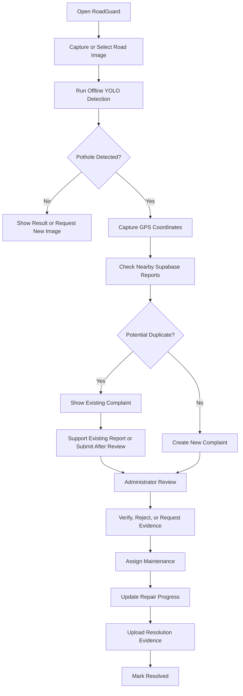
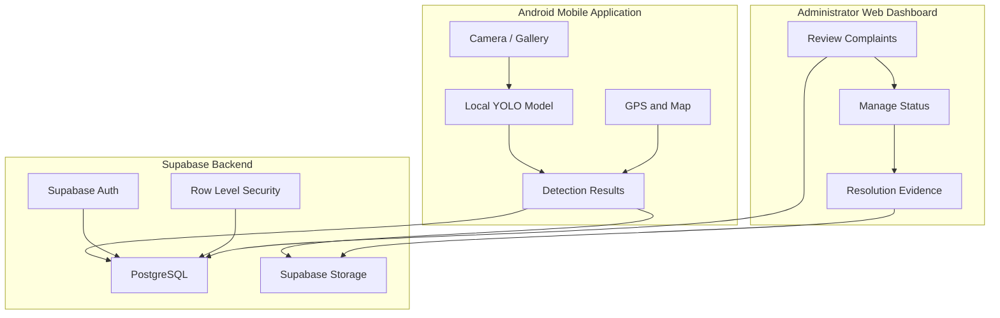

# RoadGuard 🛣️
### Offline AI-Powered Road Damage Detection & Complaint Management

RoadGuard is a mobile-first road damage reporting platform that uses on-device computer vision to detect potholes, capture their GPS location, identify potential duplicate complaints, and track reports through a complete review and resolution workflow.

Built as a college year-end project, RoadGuard combines **offline YOLO-based object detection, mobile development, geospatial data, and a secure backend** to address a practical civic problem.

> **Core principle:** Detect locally, report transparently, verify responsibly, and track every complaint.

---

## 📌 Table of Contents

- [Overview](#-overview)
- [Key Features](#-key-features)
- [Application Workflow](#-application-workflow)
- [Architecture](#-architecture)
- [Technology Stack](#-technology-stack)
- [Project Structure](#-project-structure)
- [Prerequisites](#-prerequisites)
- [Getting Started](#-getting-started)
- [Environment Configuration](#-environment-configuration)
- [Database and Security](#-database-and-security)
- [Machine Learning Pipeline](#-machine-learning-pipeline)
- [Complaint Lifecycle](#-complaint-lifecycle)
- [Testing](#-testing)
- [Android Demonstration](#-android-demonstration)
- [Evaluation Metrics](#-evaluation-metrics)
- [Limitations](#-limitations)
- [Future Enhancements](#-future-enhancements)
- [Contributing](#-contributing)
- [License](#-license)

---

## 🌍 Overview

Potholes and damaged road surfaces can create safety risks for motorists, cyclists, and pedestrians. Reporting these issues manually can be inconvenient, and multiple people may submit complaints about the same location without knowing that a report already exists.

RoadGuard aims to simplify this process through a mobile application that:

1. Detects suspected potholes from photographs using a locally executed YOLO model.
2. Captures the user's geographic location.
3. Checks for nearby road-damage reports.
4. Identifies potential duplicate complaints using location and available image evidence.
5. Allows uncertain cases to be reviewed by an administrator.
6. Tracks complaints from submission to resolution.

The system is designed to work on a real Android phone, not just inside a desktop browser or emulator.

### Project Goals

- Implement practical computer vision using an offline model.
- Develop a usable Android application.
- Integrate GPS and map-based reporting.
- Build a secure backend using Supabase.
- Provide transparent complaint verification and tracking.
- Demonstrate an end-to-end software engineering workflow.

---

## ✨ Key Features

### 📷 1. Offline Pothole Detection

- Capture a road image or select one from the gallery.
- Run a YOLO-based object detection model directly on the device.
- Display detected potholes with bounding boxes and confidence scores.
- Handle low-confidence predictions and inference failures explicitly.
- Perform core image inference without requiring an internet connection.

Offline inference depends on the compatible model and runtime being packaged and functioning correctly on the target device.

### 📍 2. GPS-Based Reporting

- Capture the device's current location.
- Record latitude, longitude, and GPS accuracy.
- Display the selected position on a map.
- Allow users to correct inaccurate GPS positions.
- Associate submitted evidence with the selected location.

### 🔎 3. Duplicate Complaint Detection

Before creating a new complaint, RoadGuard checks for relevant existing reports within a configurable geographic radius.

Potential matches can be evaluated using:

- Geographic distance.
- Damage category.
- Existing complaint status.
- Image similarity, when implemented.
- Additional street-level imagery evidence, when available.

A nearby report is not automatically proof that two photographs show the same pothole.

When a match is uncertain, the application allows the user or administrator to review the evidence.

### 🗂️ 4. Complaint Management

Each complaint has a unique identifier and a traceable history.

Users can view their reports, monitor status changes, and provide additional evidence where supported.

### 🛠️ 5. Administrator Dashboard

The web dashboard is designed to support:

- Complaint review and verification.
- Duplicate identification and linking.
- Assignment to a responsible maintenance team.
- Status updates and resolution notes.
- Repair evidence uploads.
- Complaint filtering and location-based visualization.
- Basic road-condition analytics.

### 🗺️ 6. Map-Based Visualization

View reported road damage using geographic coordinates and map markers.

OpenStreetMap-compatible map data can be used for the initial implementation. Map display availability depends on network access and the selected tile provider.

### 🔐 7. Secure Backend

Supabase provides the backend foundation for:

- Authentication.
- PostgreSQL data storage.
- Image and evidence storage.
- Access control through Row Level Security.
- Complaint history and status management.

### 🎨 8. Clean, Professional Interface

RoadGuard uses a minimal civic-technology design:

- White backgrounds.
- Clear typography.
- Restrained green accents.
- Simple navigation.
- Accessible forms and status indicators.
- Real road imagery instead of decorative AI graphics.

---

## 🔄 Application Workflow



**Important:** YOLO detects visual patterns in images. It does not independently verify the physical location, determine whether the road is officially unsafe, or guarantee that a complaint is valid.

---

## 🏗️ Architecture

RoadGuard separates mobile inference, backend services, and administrative functionality.



The local YOLO inference pipeline does not require a cloud AI API. Supabase is used for data persistence and online synchronization.

Street-level imagery verification is optional and depends on the availability, licensing, and configuration of a compatible imagery provider.

---

## 🧰 Technology Stack

| Component | Technology |
|---|---|
| Mobile application | React Native, Expo, TypeScript |
| Mobile navigation | Expo Router |
| Object detection | YOLO |
| Model development | Python, PyTorch, Ultralytics |
| Image processing | OpenCV |
| On-device inference | Compatible ONNX Runtime or TensorFlow Lite runtime |
| Backend and authentication | Supabase |
| Database | PostgreSQL |
| File storage | Supabase Storage |
| Administrator dashboard | Next.js, TypeScript |
| Maps | OpenStreetMap-compatible map integration |
| Version control | Git and GitHub |

The exact inference runtime and model export format must match the implementation used by the application.

---

## 📁 Project Structure

The following is the intended structure. Adjust paths to match the actual repository.

```text
RoadGuard/
├── apps/
│   ├── mobile/
│   │   ├── app/
│   │   ├── components/
│   │   ├── services/
│   │   ├── assets/
│   │   │   └── models/
│   │   └── package.json
│   │
│   └── admin/
│       ├── app/
│       ├── components/
│       ├── lib/
│       └── package.json
│
├── ml/
│   ├── dataset/
│   ├── train.py
│   ├── evaluate.py
│   └── export_model.py
│
├── supabase/
│   ├── migrations/
│   ├── functions/
│   └── seed.sql
│
├── docs/
│   ├── architecture.md
│   ├── database.md
│   └── demo-guide.md
│
├── .gitignore
├── .env.example
└── README.md
```

Do not commit private datasets, downloaded model weights with incompatible licenses, build artifacts, or credentials.

---

## ⚙️ Prerequisites

Install the tools required by the actual repository:

- Node.js LTS.
- npm or the package manager specified in the repository.
- Python 3 and the ML dependencies.
- Android Studio and Android SDK.
- Java version compatible with the selected Android build tooling.
- Expo tooling and the required native development environment.
- A Supabase account.
- Git.

For model training, a compatible NVIDIA GPU is helpful but not mandatory. A smaller model and reduced training configuration can be used when GPU memory is limited.

**Development and demonstration requirements differ:** running the frontend in a browser does not prove that offline model inference works on Android.

---

## 🚀 Getting Started

### 1. Clone the repository

```bash
git clone <YOUR_GITHUB_REPOSITORY_URL>
cd RoadGuard
```

Replace the placeholder with the actual repository URL.

### 2. Install dependencies

Use the actual package manager and workspace configuration in the repository.

For a monorepo that uses npm workspaces:

```bash
npm install
```

If the mobile and admin applications are independent projects, install their dependencies in their respective directories instead.

### 3. Create a Supabase project

1. Create a project in the [Supabase Dashboard](https://supabase.com/dashboard).
2. Copy the Project URL.
3. Copy the Publishable key.
4. Apply the database migrations.
5. Configure Storage buckets and access policies.
6. Configure authentication settings.
7. Create the initial administrator using the documented secure setup process.

### 4. Configure environment variables

Create the environment files required by the actual application.

For example:

```text
apps/mobile/.env
apps/admin/.env.local
```

Refer to `.env.example` for the required variable names.

Never commit real environment files.

### 5. Apply database migrations

Use the migration workflow documented in the repository and verify that all tables, indexes, policies, and required database extensions are present.

Do not assume that creating the Supabase project automatically creates the RoadGuard schema.

### 6. Run the mobile application

Follow the mobile application's documented development command.

For example, a standard Expo project may use:

```bash
npx expo start
```

A custom native inference runtime may require a development build rather than Expo Go.

### 7. Run the administrator dashboard

For a standard Next.js application:

```bash
npm run dev
```

Run this command from the administrator application's directory if it is an independent package.

### 8. Build an Android APK

Use the build configuration supported by the project. A local Gradle build may resemble:

```bash
cd apps/mobile/android
./gradlew assembleDebug
```

On Windows:

```powershell
cd apps/mobile/android
.\gradlew.bat assembleDebug
```

The actual APK output path depends on the Android build configuration. Verify the generated file before attempting installation.

---

## 🔑 Environment Configuration

Use `.env.example` as the reference for all environment variables.

Typical variables include:

| Variable | Purpose |
|---|---|
| `EXPO_PUBLIC_SUPABASE_URL` | Supabase URL for the mobile app |
| `EXPO_PUBLIC_SUPABASE_ANON_KEY` | Public client key for the mobile app |
| `NEXT_PUBLIC_SUPABASE_URL` | Supabase URL for the admin dashboard |
| `NEXT_PUBLIC_SUPABASE_ANON_KEY` | Public client key for the admin dashboard |
| `SUPABASE_SERVICE_ROLE_KEY` | Optional privileged server-side credential |
| `EXPO_PUBLIC_MODEL_FILENAME` | Configured model filename, if supported by the app |
| `EXPO_PUBLIC_DETECTION_CONFIDENCE_THRESHOLD` | Detection threshold configuration |
| `EXPO_PUBLIC_UNCERTAIN_CONFIDENCE_THRESHOLD` | Uncertainty threshold configuration |
| `EXPO_PUBLIC_DUPLICATE_RADIUS_METERS` | Initial nearby-report search radius |
| `EXPO_PUBLIC_MAPILLARY_ACCESS_TOKEN` | Optional imagery-provider configuration |

The two public Supabase URL variables normally contain the same value. The two public client-key variables also normally contain the same value.

**Security requirements:**

- Never expose a Supabase service-role or secret key to the mobile app or browser.
- Keep privileged credentials on trusted server-side infrastructure.
- Enable and test Row Level Security.
- Treat all public client configuration as visible to users.
- Never commit `.env`, `.env.local`, private keys, or production credentials.

---

## 🗄️ Database and Security

The database should support the following entities:

- **Profiles:** user identity and application role.
- **Complaints:** coordinates, damage category, status, and reporting metadata.
- **Complaint evidence:** original images, additional photographs, and repair evidence.
- **Complaint contributions:** community confirmations and additional reports.
- **Status history:** traceable changes and administrative actions.

Use foreign keys, indexes, validation, and access policies to maintain consistency.

### Security principles

- Users can create reports only as themselves.
- Administrative privileges must be checked server-side.
- Users must not be able to assign themselves an administrator role.
- Complaint status changes must follow permitted transitions.
- Private evidence must not be accessible through unrestricted public URLs.
- Sensitive operations should be validated and authorized by trusted backend code.

---

## 🧠 Machine Learning Pipeline

RoadGuard uses YOLO-based object detection to identify suspected potholes.

The machine learning workflow consists of:

1. Dataset collection and license verification.
2. Annotation validation and dataset preparation.
3. Train, validation, and test splitting.
4. Model training or fine-tuning.
5. Model evaluation and threshold selection.
6. Export to the chosen mobile inference format.
7. Android integration and on-device testing.
8. Real-world error analysis.

### Detection output

The model should return:

- Predicted damage class.
- Bounding-box coordinates.
- Confidence score.
- Inference duration.
- An explicit failure or uncertain state where appropriate.

### Verification is not the same as detection

A high-confidence prediction means the model detected a visual pattern. It does not independently prove the location or validity of a complaint.

RoadGuard therefore combines visual detection with GPS data, nearby reports, and administrative review.

Dataset attribution, model licensing, and any redistribution restrictions must be documented.

---

## 📋 Complaint Lifecycle

A complaint may move through these statuses:

| Status | Meaning |
|---|---|
| `pending_verification` | Submitted and awaiting review |
| `verified` | Reviewed and accepted |
| `assigned` | Assigned to a responsible team |
| `in_progress` | Repair work is underway |
| `resolved` | Resolution has been recorded |
| `rejected` | Reviewed and rejected with a reason |
| `duplicate` | Linked to an existing complaint |

The administrator can review evidence, merge duplicates, assign responsibility, update progress, and attach resolution photographs.

A duplicate report should retain its history and reference the original complaint rather than silently disappearing.

Unless an authorized municipal integration has actually been implemented, these statuses represent RoadGuard's own complaint-management workflow.

---

## 🧪 Testing

Test the complete application rather than only individual screens.

### Mobile testing
- Camera and gallery access.
- GPS permission and location accuracy.
- Manual map-pin adjustment.
- On-device YOLO inference.
- Low-confidence and no-detection cases.
- Offline inference in airplane mode.
- Data synchronization after reconnecting.

### Backend testing
- Authentication and session handling.
- Database persistence.
- Storage permissions.
- Row Level Security.
- Duplicate detection.
- Complaint status transitions.
- Administrator authorization.

### End-to-end testing
1. Capture a pothole photograph.
2. Run the local model.
3. Capture and verify the location.
4. Check for existing nearby complaints.
5. Submit a new complaint or support an existing one.
6. Confirm persistence in Supabase.
7. Review the complaint through the administrator dashboard.
8. Update its status.
9. Upload resolution evidence.
10. Confirm that the user sees the updated status.

Record actual test results and document failures. Do not claim that a test passed unless it has been executed.

---

## 📱 Android Demonstration

The final college demonstration should use a real Android phone.

Suggested demonstration sequence:

1. Launch RoadGuard on the phone.
2. Capture a road image.
3. Disable internet access and run pothole detection.
4. Display the detected pothole and confidence score.
5. Restore connectivity.
6. Capture GPS coordinates and view the map.
7. Check nearby existing reports.
8. Submit the complaint.
9. Open the administrator dashboard on a laptop.
10. Verify the complaint and assign it.
11. Update the status and attach repair evidence.
12. Show the updated complaint history on the phone.

For the offline test, verify that the application runs inference without relying on a backend response. Cloud synchronization naturally requires connectivity.

Use genuine photographs and real database records during the final demonstration.

---

## 📊 Evaluation Metrics

Evaluate the object detection model using appropriate held-out test data.

| Metric | Purpose |
|---|---|
| Precision | Measures the proportion of predicted detections that are correct |
| Recall | Measures the proportion of annotated potholes detected |
| mAP@0.5 | Measures detection quality at IoU threshold 0.50 |
| mAP@0.5:0.95 | Measures detection quality across stricter IoU thresholds |
| Inference latency | Measures per-image processing time |
| FPS | Measures video-processing throughput, if supported |

Also evaluate GPS accuracy, duplicate-matching errors, complaint submission success, and backend response times.

Report measured values only after running the evaluation. Do not invent model accuracy or claim that the system is more reliable than it has been shown to be.

---

## ⚠️ Limitations

- Pothole detection depends on image quality, lighting, road conditions, and training data.
- GPS coordinates can be inaccurate, particularly in dense urban areas.
- Nearby reports may refer to different potholes.
- Satellite imagery and street-level imagery may be unavailable, outdated, or unsuitable for verification.
- Map tiles and cloud synchronization may require internet connectivity.
- A detection result is not a professional road-safety assessment.
- Complaint submission does not guarantee that a municipal authority has received the report.
- Performance depends on the target phone's hardware and the selected inference runtime.

---

## 🚧 Future Enhancements

Potential future improvements include:

- Video-based pothole detection.
- Community verification and reputation mechanisms.
- More advanced image similarity for duplicate detection.
- Offline map support.
- Improved road-damage severity estimation.
- Repair progress notifications.
- Municipal API integration where authorized.
- Historical road-condition analytics.
- Additional damage categories, such as cracks and damaged road markings.
- Model optimization for faster inference and lower memory usage.

---

## 🤝 Contributing

Contributions are welcome.

1. Create a branch for the feature or fix.
2. Make focused, documented changes.
3. Run relevant tests.
4. Review your changes for security issues and unintended files.
5. Submit a pull request when the repository's collaboration workflow permits.

Do not commit credentials, private datasets, or model files whose licensing prohibits redistribution.

---

## 📄 License

Choose and add an appropriate open-source license before publishing the repository. Verify that the application dependencies, training datasets, and model weights permit the intended use and redistribution.

---

## 🎓 Project Information

**Project:** RoadGuard  
**Category:** Computer Vision, Mobile Development, Backend Engineering  
**Primary model:** YOLO-based offline object detection  
**Backend:** Supabase  
**Mobile platform:** Android  
**Project purpose:** College year-end project and practical demonstration

Built to explore how on-device computer vision and location-aware reporting can support more transparent road-damage management.

---

*RoadGuard is a reporting and decision-support system. Detection results and complaint statuses should always reflect the evidence actually available.*
