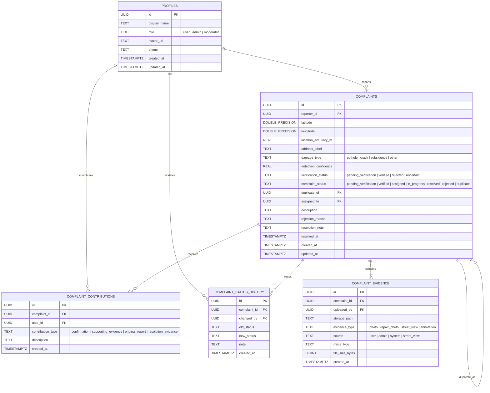

# RoadGuardAI — Stage 0 Baseline Audit & Project Verification

**Document Version:** 1.0.0  
**Audit Date:** 2026-11-22  
**Auditor:** Antigravity Engineering Agent  
**Repository Working Directory:** `c:\Users\Biswas Gupta\Downloads\mini project`  
**Repository Git Origin:** `https://github.com/ANURODHOP/RoadGuardAI.git`  

---

## 1. Executive Summary

RoadGuardAI is an end-to-end civic-technology platform designed to identify road surface damage (specifically potholes), capture accurate geospatial coordinates, check for existing nearby duplicate complaints within a 30-meter radius, and track citizen tickets through a structured review, assignment, and resolution lifecycle.

The project is structured as a monorepo comprising:
1. **Mobile Application (`apps/mobile`)**: React Native / Expo application targeting Android, featuring on-device YOLOv8 inference via ONNX Runtime, GPS capture, map pin adjustment, and ticket tracking.
2. **Administrator Web Dashboard (`apps/admin`)**: Next.js 16 App Router application for municipal staff to review, verify, reject, assign to field crews, and mark complaints resolved.
3. **Backend & Security Infrastructure (`supabase/`)**: Supabase PostgreSQL database utilizing Row Level Security (RLS), triggers, spatial search via PostgreSQL's `earthdistance` and `cube` extensions, Supabase Storage buckets, and a Deno Edge Function (`admin-action`).
4. **Machine Learning Pipeline (`ml/`)**: Ultralytics YOLOv8 Python scripts for dataset download, training, ONNX export (opset 12, $320\times320$), and export validation.
5. **Integration Test Suite (`tests/`)**: TypeScript integration suites verifying multi-user isolation and RLS policies.

### Core Audit Verdict

While the overall software architecture, database migrations, RLS policies, and user interface workflows are thoughtfully designed and implemented, this audit uncovered **critical discrepancies between documented claims and actual source code implementation**:
- **Bundled Model Identity**: The bundled model `apps/mobile/assets/models/pothole_yolov8n.onnx` is actually an export of the official 80-class COCO-pretrained YOLOv8n model, **not** a model fine-tuned on pothole datasets (confirmed by `ml/models/MODEL_SOURCE.txt`). Any COCO object detected with $\ge 40\%$ confidence is reported as "Road Damage Detected".
- **Mobile Image Preprocessing Flaw**: `apps/mobile/src/lib/inference.ts` decodes JPEG base64 strings by seeking the `0xFFDA` (Start of Scan) marker and treating subsequent bytes as uncompressed RGB values. Because JPEG scan data consists of entropy-coded (Huffman/DCT) compressed bitstreams, the model is fed pseudo-random high-frequency noise rather than valid image pixel data.
- **Offline Submission Gap**: While local ONNX inference is designed to work offline, complaint submission requires active network connectivity and live Supabase JWT authentication. The offline draft storage and synchronization queue described in `docs/known-limitations.md` is **not implemented** in the mobile app.
- **Runtime Environment Constraint**: `onnxruntime-react-native` contains custom native C++ libraries and cannot execute inside Expo Go. As documented in `apps/mobile/src/lib/onnx-polyfill.ts`, offline inference requires a custom EAS development build or standalone Android APK.
- **Missing Local Environment**: No active `.env` file exists in the workspace. All integration tests require live Supabase credentials (`SUPABASE_URL`, `SUPABASE_ANON_KEY`, `SUPABASE_SERVICE_ROLE_KEY`) and cannot run in a headless offline sandbox.

---

## 2. Verified Project Architecture

```
RoadGuard/
├── .env.example                               # Environment variable template
├── .gitignore                                 # Git ignore patterns
├── package.json                               # Monorepo root (npm workspaces: apps/mobile, apps/admin)
├── README.md                                  # Project overview and instructions
├── apps/
│   ├── mobile/                                # React Native / Expo Android application
│   │   ├── app/                               # Expo Router screens (tabs, auth, modals)
│   │   ├── assets/models/                     # Bundled ONNX model (pothole_yolov8n.onnx, 12.13 MB)
│   │   ├── src/lib/                           # Supabase client, ONNX inference, theme
│   │   ├── app.json                           # Expo app configuration and permissions
│   │   └── package.json                       # Mobile dependencies (Expo 58, RN 0.88.1, React 19.3.0)
│   └── admin/                                 # Next.js 16 Web Dashboard
│       ├── app/                               # App Router (dashboard, auth, API routes)
│       ├── components/                        # Header, Sidebar, KpiCard, StatusBadge
│       ├── lib/                               # Supabase SSR and browser clients
│       └── package.json                       # Admin dependencies (Next 16.4.3, React 19.3.0)
├── ml/
│   ├── models/                                # Model source metadata (MODEL_SOURCE.txt)
│   ├── scripts/                               # Training, ONNX export, and validation scripts
│   └── requirements.txt                       # Python dependencies (ultralytics, onnxruntime, etc.)
├── supabase/
│   ├── migrations/                            # SQL migrations 001 through 006
│   ├── functions/admin-action/                # Deno Edge Function for privileged status actions
│   └── seed.sql                               # Test seed data
├── tests/
│   ├── multi-user.test.ts                     # Live integration test: multi-user isolation
│   ├── security.test.ts                       # Live integration test: RLS & constraint verification
│   └── package.json                           # Test dependencies (@supabase/supabase-js, ts-node)
├── scripts/
│   └── create_admin.js                        # Node.js CLI script to provision admin profiles
└── docs/                                      # Technical architecture & specification documents
```

### Technology Matrix & Verification Status

| Tier | Component | Claimed Technology | Verified Code Implementation | Status |
|---|---|---|---|---|
| **Mobile** | Framework | React Native + Expo | Expo SDK 58.0.19, React Native 0.88.1, React 19.3.0 | Verified (`apps/mobile/package.json`) |
| **Mobile** | Navigation | Expo Router | Expo Router 58.0.30 (`apps/mobile/app/_layout.tsx`) | Verified |
| **Mobile** | ML Runtime | ONNX Runtime Mobile | `onnxruntime-react-native` 1.24.3 (`apps/mobile/src/lib/inference.ts`) | Verified (requires native build) |
| **Mobile** | Maps | OpenStreetMap | `react-native-maps` with `UrlTile` from OpenStreetMap | Verified (`apps/mobile/app/(tabs)/map.tsx`) |
| **Admin** | Web Framework | Next.js App Router | Next.js 16.4.3, React 19.3.0, Tailwind CSS v4 | Verified (`apps/admin/package.json`) |
| **Admin** | Data Layer | Supabase SSR | `@supabase/ssr` 0.12.7 (`apps/admin/lib/supabase-server.ts`) | Verified |
| **Backend** | Database | PostgreSQL | Supabase PostgreSQL with RLS, triggers, functions | Verified (`supabase/migrations/`) |
| **Backend** | Spatial Engine | PostGIS / Earthdistance | Native `earthdistance` + `cube` spherical calculations | Verified (`001_schema.sql`, `002_indexes.sql`) |
| **Backend** | Edge Functions | Deno TypeScript | `supabase/functions/admin-action/index.ts` | Verified |
| **ML** | Architecture | YOLOv8n ($320\times320$) | Ultralytics YOLOv8 export to ONNX opset 12 | Verified (`ml/scripts/export_onnx.py`) |
| **ML** | Weights | Pothole Fine-Tuned | Official Ultralytics COCO Pretrained (`MODEL_SOURCE.txt`) | **Discrepancy (COCO fallback)** |

---

## 3. Verified Mobile Application Audit (`apps/mobile`)

### 3.1 Navigation & Screen Flow
- **Router Configuration** (`apps/mobile/app/_layout.tsx#L56-L68`): File-based navigation via Expo Router `Stack`.
- **Screen Route Mapping**:
  - `/(auth)/welcome.tsx`, `sign-in.tsx`, `sign-up.tsx`, `forgot-password.tsx`: Public citizen authentication.
  - `/(tabs)/index.tsx`: Home dashboard with summary metrics, recent tickets, and "Report Road Damage" CTA.
  - `/(tabs)/map.tsx`: Interactive full-screen map showing up to 200 nearby reports using OpenStreetMap tiles.
  - `/(tabs)/reports.tsx`: Paginated infinite-scroll list of citizen's submitted reports with status chips.
  - `/(tabs)/profile.tsx`: Citizen profile view, role badge, account settings, and sign-out.
  - `/capture.tsx`: Fullscreen camera viewfinder and gallery picker modal.
  - `/detection.tsx`: On-device inference runner, bounding box renderer, and confidence card.
  - `/location-select.tsx`: Map pin adjustment and GPS reverse geocoding screen.
  - `/duplicate-check.tsx`: 30-meter proximity duplicate verification screen.
  - `/submit-complaint.tsx`: Multi-step submission form (DB record creation, photo upload, audit logging).
  - `/complaint/[id].tsx`: Ticket timeline, evidence photo gallery, status change history, and upvote contributions.
- **Hardware Back Button Handling**: Handled consistently across all screens via React Native `BackHandler` inside `useFocusEffect` (e.g. `apps/mobile/app/capture.tsx#L32-L47`, `detection.tsx#L24-L33`, `submit-complaint.tsx#L64-L73`). Prevents abrupt app exits and prompts users before discarding form state.

### 3.2 Authentication & Token Storage
- **Implementation** (`apps/mobile/src/lib/supabase.ts#L16-L93`):
  - Uses `createClient` from `@supabase/supabase-js`.
  - Implements `ExpoSecureStoreAdapter` with chunking (1,800 bytes per chunk) to overcome Android's Keystore 2,048-byte blob limitation.
  - Web fallback gracefully utilizes `localStorage`.
- **Session Protection** (`apps/mobile/app/_layout.tsx#L30-L39`): `AuthProvider` monitors `supabase.auth.onAuthStateChange` and automatically redirects unauthenticated users to `/(auth)/welcome`.

### 3.3 Camera & Photo Library Access
- **Permissions** (`apps/mobile/app.json#L14-L24`, `apps/mobile/app/capture.tsx#L50-L54`):
  - Configured with `expo-camera` (`CameraView`) and `expo-image-picker`.
  - Android permissions declared: `CAMERA`, `READ_EXTERNAL_STORAGE`, `WRITE_EXTERNAL_STORAGE`.
  - If gallery permissions are denied, an alert directs the citizen to Android system settings via `Linking.openSettings()` (`apps/mobile/app/capture.tsx#L133-L141`).
- **Image Resizing & Compression** (`apps/mobile/app/capture.tsx#L97-L105`): Captured photos are downsampled to a maximum width of 1,024 px with 0.85 JPEG compression using `expo-image-manipulator` prior to inference or upload.

### 3.4 On-Device ONNX Inference Engine
- **Model Loading** (`apps/mobile/src/lib/inference.ts#L55-L85`):
  - Model bundled at `apps/mobile/assets/models/pothole_yolov8n.onnx` (12.13 MB).
  - Loaded into memory using `Asset.fromModule()` and `InferenceSession.create()`.
  - Concurrency guard: `_loadPromise` ensures simultaneous calls do not attempt duplicate session initializations.
- **Preprocessing Implementation & Flaw** (`apps/mobile/src/lib/inference.ts#L146-L228`):
  - Image is resized to $320\times320$ JPEG via `manipulateAsync`.
  - The function `decodeBase64JpegToRgb` scans for the JPEG Start-of-Scan marker (`0xFF 0xDA`), skips 12 bytes, and then maps subsequent raw bytes directly into an RGB `Uint8ClampedArray`.
  - **Identified Defect**: JPEG data after the SOS marker is **entropy-coded bitstream (variable-length Huffman codes representing quantized DCT coefficients)**, not uncompressed RGB or raster pixel values. As a result, the Float32 tensor fed into YOLOv8 is entropy noise. The author included an inline code comment noting that `jpeg-js` or native decoding should be used, but this was never integrated.
- **Postprocessing & Non-Maximum Suppression (NMS)** (`apps/mobile/src/lib/inference.ts#L237-L330`):
  - Parses YOLOv8 tensor shape `[1, 84, 2100]` (or `[1, 5, 2100]` for single-class models).
  - Iterates over all 2,100 anchors, computes bounding box coordinates (`cx, cy, w, h`), and extracts maximum class confidence.
  - Implements greedy NMS (`apps/mobile/src/lib/inference.ts#L297-L313`) with IoU threshold $0.45$.
  - Assigns detection states:
    - `pothole_detected`: Top confidence $\ge 0.40$ (`CONF_HIGH`).
    - `uncertain_low_confidence`: Confidence between $0.25$ (`CONF_LOW`) and $0.39$.
    - `no_pothole_detected`: No anchors exceed $0.25$.
- **Bounding Box Screen Mapping** (`apps/mobile/app/detection.tsx#L122-L124`): Normalized coordinates $[0, 1]$ are scaled to screen display dimensions ($W \times H$).

### 3.5 Geospatial Capture & Location Adjustment
- **GPS Coordinates Capture** (`apps/mobile/app/capture.tsx#L74-L95`): Uses `expo-location` with `Accuracy.Balanced`. Records `latitude`, `longitude`, and `accuracy` (in meters).
- **Interactive Pin Adjustment** (`apps/mobile/app/location-select.tsx#L36-L75`):
  - Displays map centered at device coordinates.
  - Allows citizens to drag the pin or tap anywhere on the map to correct GPS drift.
  - Automatically triggers reverse geocoding via `Location.reverseGeocodeAsync` to produce human-readable road labels.

### 3.6 Proximity Duplicate Check
- **Execution** (`apps/mobile/app/duplicate-check.tsx#L58-L70`):
  - Invokes `fetchNearbyComplaints(lat, lon, 30)` which calls Supabase RPC `nearby_complaints`.
  - If existing active reports exist within 15 meters with status `verified`, `in_progress`, or `assigned`, state is marked `existing_unresolved`.
  - Offers citizen the choice to "Support Existing Report" (avoiding duplicate tickets) or "Proceed with Separate Report".

### 3.7 Submission Workflow & Double-Tap Prevention
- **Locking** (`apps/mobile/app/submit-complaint.tsx#L46, L86-L87`): `isSubmittingRef` lock prevents duplicate ticket generation on rapid double-tap.
- **Database-First Pattern** (`apps/mobile/app/submit-complaint.tsx#L125-L168`):
  - Step 1: Inserts complaint row into `public.complaints`. Obtains generated UUID `complaintId`.
  - Step 2: Uploads photo to Supabase Storage at scoped path `complaints/{complaintId}/{userId}/photo_{timestamp}.jpg`.
  - Step 3: Inserts evidence metadata into `public.complaint_evidence`.
  - Step 4: Inserts initial audit contribution into `public.complaint_contributions`.
- **Upload Validation** (`apps/mobile/src/lib/supabase.ts#L235-L250`): Validates file size ($\le 10$ MB) and MIME types (`image/jpeg`, `image/png`, `image/webp`, `image/heic`).

---

## 4. Verified Machine Learning Audit (`ml/`)

### 4.1 Dataset & Source Configuration
- **Target Dataset Reference** (`ml/scripts/train.py#L7-L9`, `download_model.py#L7-L9`):
  - Dataset: "Pothole Detection" by Roboflow 100 (`roboflow-100/pothole-detection-gwyag`, Version 2).
  - License: CC BY 4.0.
  - Split: Automated by Roboflow (Train/Val/Test).
- **Physical Dataset Presence**: **No dataset files exist on disk** in `ml/datasets/`. The directory is empty.

### 4.2 Actual Bundled Model Identity & Weights
- **Model Path**: `apps/mobile/assets/models/pothole_yolov8n.onnx` (12,725,050 bytes / 12.13 MB).
- **Model Metadata** (`ml/models/MODEL_SOURCE.txt`):
  ```text
  Model: YOLOv8n (COCO pretrained)
  Source: Ultralytics official weights
  License: AGPL-3.0
  Limitation: Not fine-tuned for potholes. Uses COCO class detection.
  Classes used: All 80 COCO classes (road hazards detected as general objects)
  Recommendation: Run train.py with a pothole dataset for better accuracy.
  ```
- **Audit Finding**: The bundled ONNX model is **not** a pothole detector; it is the base COCO YOLOv8n network with 80 classes. In `apps/mobile/src/lib/inference.ts#L254-L270`, the mobile app computes the highest confidence across whatever class the model fires on and treats it as a road damage detection if confidence exceeds $0.40$.

### 4.3 Training Script Specifications (`ml/scripts/train.py`)
- **Base Architecture**: `yolov8n.pt` (Ultralytics YOLOv8 nano).
- **Hyperparameters**:
  - Epochs: 50 (or user-configurable).
  - Image size: $320\times320$.
  - Batch size: 8.
  - Optimizer: `AdamW` (`lr0=0.001`, `cos_lr=True`).
  - Augmentations: `degrees=5.0`, `fliplr=0.5`, `mosaic=0.5`, `mixup=0.0`.
  - Early stopping patience: 20 epochs.

### 4.4 ONNX Export Pipeline (`ml/scripts/export_onnx.py`)
- **Target Format**: ONNX.
- **Image Dimension**: Fixed $320\times320$.
- **Opset Version**: 12 (required for ONNX Runtime Mobile C++ compatibility).
- **Optimization Flags**: `simplify=True`, `dynamic=False`.
- **Destination**: Automates copying output to `apps/mobile/assets/models/pothole_yolov8n.onnx`.

### 4.5 Evaluation & Validation Scripts
- **Inference Simulator** (`ml/scripts/test_inference.py`):
  - 8-step test suite verifying session loading, synthetic road image without pothole, road with dark patch, zero-byte/black image, confidence thresholds, simulated offline execution (blocking network sockets), and latency benchmarking.
- **Consistency Validator** (`ml/scripts/validate_export.py`):
  - Compares raw PyTorch predictions from `best.pt` against ONNX Runtime predictions on the same input image to verify numerical parity within $\pm 0.05$ confidence tolerance.

---

## 5. Verified Backend Audit (`supabase/`)

### 5.1 Database Extensions
Verified in `supabase/migrations/001_schema.sql#L9-L12`:
- `uuid-ossp`: For UUID primary key generation.
- `cube`: Multi-dimensional vector math extension.
- `earthdistance`: Great-circle spherical distance calculations on the earth's surface.

### 5.2 Schema & Entity Relationships



### 5.3 Automated Triggers & State Integrity
1. **User Profile Auto-Creation** (`001_schema.sql#L28-L46`): Trigger `on_auth_user_created` automatically inserts a row into `public.profiles` upon Supabase `auth.users` insertion.
2. **Status Transition Validation** (`006_security_hardening.sql#L27-L72`): Trigger `validate_complaint_status` validates status transitions against an allowed whitelist:
   - `pending_verification` $\to$ `verified`, `rejected`, `duplicate`.
   - `verified` $\to$ `assigned`, `rejected`.
   - `assigned` $\to$ `in_progress`, `rejected`.
   - `in_progress` $\to$ `resolved`, `assigned`.
   - `resolved` $\to$ `resolved` (allows attaching additional resolution proof).
   - `duplicate` $\to$ `pending_verification` (allows unmarking duplicates).
   - Any other jump (e.g. `pending_verification` directly to `resolved`) throws a SQL exception (`check_violation`).
3. **Audit History Logging** (`006_security_hardening.sql#L80-L100`): Trigger `auto_record_status_history` is marked `SECURITY DEFINER` and automatically records previous status, new status, timestamp, and modifying user into `complaint_status_history`.
4. **Column Modification Restrictions** (`003_rls_fixes.sql#L251-L292`): Trigger `enforce_complaint_update_columns` guarantees that regular users cannot modify coordinates, status, verification, or assignment fields, even if they submit an UPDATE query. Any field other than `description` is forced back to its `OLD` value unless the caller has role `admin` or `moderator`.

### 5.4 Spatial Proximity RPC Function
Implemented in `supabase/migrations/003_rls_fixes.sql#L95-L149`:
```sql
CREATE OR REPLACE FUNCTION public.nearby_complaints(
  user_lat DOUBLE PRECISION,
  user_lon DOUBLE PRECISION,
  radius_meters DOUBLE PRECISION DEFAULT 30.0,
  exclude_id UUID DEFAULT NULL
)
RETURNS TABLE (...)
LANGUAGE plpgsql STABLE SECURITY INVOKER AS $$
BEGIN
  IF auth.uid() IS NULL THEN
    RAISE EXCEPTION 'Authentication required';
  END IF;

  RETURN QUERY
  SELECT
    c.id, c.latitude, c.longitude, c.damage_type, c.complaint_status,
    c.verification_status, c.detection_confidence, c.address_label, c.created_at,
    earth_distance(ll_to_earth(c.latitude, c.longitude), ll_to_earth(user_lat, user_lon)) AS distance_meters
  FROM public.complaints c
  WHERE
    c.complaint_status NOT IN ('rejected', 'resolved')
    AND (exclude_id IS NULL OR c.id != exclude_id)
    AND earth_distance(ll_to_earth(c.latitude, c.longitude), ll_to_earth(user_lat, user_lon)) <= radius_meters
  ORDER BY distance_meters ASC
  LIMIT 20;
END;
$$;
```

### 5.5 Storage Configuration & Policies (`005_storage_policies.sql`)
- **Bucket**: `evidence` (private, non-public bucket).
- **File Limit**: 10,485,760 bytes (10 MB).
- **MIME Whitelist**: `image/jpeg`, `image/png`, `image/webp`, `image/heic`, `image/heif`.
- **Path Enforced Storage RLS**:
  - `INSERT`: Enforces that segment 3 of the storage path matches the authenticated user ID (`split_part(name, '/', 3) = auth.uid()::text`). Users cannot overwrite files belonging to other citizens.
  - `SELECT`: Restricted to authenticated users for generating signed URLs with 1-hour expiration.

### 5.6 Privileged Server Operations
- **Edge Function** (`supabase/functions/admin-action/index.ts`):
  - Deno TypeScript function.
  - Authenticates incoming Bearer token, queries `profiles` for `role IN ('admin', 'moderator')`.
  - Performs privileged operations using `SUPABASE_SERVICE_ROLE_KEY`.
- **Next.js Server API Route** (`apps/admin/app/api/admin/action/route.ts`):
  - Server-side Next.js route handler mirroring the Edge Function capabilities.
  - Verifies admin session cookies before updating complaints or inserting status notes.

---

## 6. Verified Admin Dashboard Audit (`apps/admin`)

### 6.1 Authentication & Role-Based Access Control
- **Login Screen** (`apps/admin/app/page.tsx#L20-L46`): Authenticates against Supabase Auth. Queries `profiles.role` to ensure user is `admin` or `moderator`. Rejects non-admin users with an explicit access denied message.
- **Server-Side Session Guard** (`apps/admin/app/dashboard/layout.tsx#L8-L21`): Server component layout uses `@supabase/ssr` cookies. Unauthenticated users or non-admin roles are immediately redirected to `/`.

### 6.2 Complaints Management & Operations
- **Server-Side Filterable Registry** (`apps/admin/app/dashboard/complaints/page.tsx`):
  - Server Component rendering 25 records per page (`PAGE_SIZE = 25`).
  - Supports search by complaint ID, address label, or damage type.
  - URL-driven filtering: `?status=verified&damage=pothole&page=2`.
- **Detail View & Action Controls** (`apps/admin/app/dashboard/complaints/[id]/page.tsx`):
  - Inspects evidence photos via generated signed URLs.
  - Action buttons:
    - **Verify**: Moves status from `pending_verification` $\to$ `verified`.
    - **Reject**: Opens modal requiring mandatory `rejection_reason`.
    - **Assign**: Assigns complaint to field maintenance team.
    - **Mark Duplicate**: Links `duplicate_of` parent UUID.
    - **Resolve**: Opens modal requiring mandatory `resolution_note`.
  - Audited Timeline: Displays all prior status changes from `complaint_status_history` and citizen contributions from `complaint_contributions`.

### 6.3 Analytics & GIS Spatial Monitoring
- **Performance Analytics** (`apps/admin/app/dashboard/analytics/page.tsx`):
  - Calls `get_complaint_stats()` RPC to compute total, pending, verified, assigned, resolved, and duplicate counts.
  - Computes average resolution time in hours.
  - Renders damage distribution demographics and AI detection confidence tiers.
- **GIS Map Visualization** (`apps/admin/app/dashboard/map/page.tsx`, `MapClientView.tsx`):
  - Queries up to 250 geocoded active incidents.
  - Embeds OpenStreetMap via iframe (`MapClientView.tsx#L83`) centered dynamically on the selected incident coordinates.
  - Interactive sidebar lists incidents with search, status filtering, and coordinates inspection.

### 6.4 User Directory & Configuration
- **Users Directory** (`apps/admin/app/dashboard/users/page.tsx`): Uses `createAdminClient()` with service-role privileges to list registered citizen profiles, roles, and complaint counts.
- **System Settings** (`apps/admin/app/dashboard/settings/page.tsx`): Displays current admin identity, database connection status, and operational thresholds.

---

## 7. Database Schema Overview

| Table Name | Primary Key | Foreign Keys | Key Columns | Purpose |
|---|---|---|---|---|
| `profiles` | `id` (UUID) | `auth.users(id)` | `display_name`, `role`, `avatar_url`, `phone` | Citizen & admin profiles |
| `complaints` | `id` (UUID) | `reporter_id` $\to$ `profiles`, `assigned_to` $\to$ `profiles`, `duplicate_of` $\to$ `complaints` | `latitude`, `longitude`, `damage_type`, `detection_confidence`, `complaint_status`, `verification_status`, `address_label` | Core damage tickets |
| `complaint_evidence` | `id` (UUID) | `complaint_id` $\to$ `complaints`, `uploaded_by` $\to$ `profiles` | `storage_path`, `evidence_type`, `source`, `mime_type`, `file_size_bytes` | Evidence photo metadata |
| `complaint_contributions` | `id` (UUID) | `complaint_id` $\to$ `complaints`, `user_id` $\to$ `profiles`, `evidence_id` $\to$ `complaint_evidence` | `contribution_type`, `description` | Community confirmations & support |
| `complaint_status_history` | `id` (UUID) | `complaint_id` $\to$ `complaints`, `changed_by` $\to$ `profiles` | `old_status`, `new_status`, `note` | Immutable audit trail |

---

## 8. Current Duplicate Detection Logic

1. **Spatial Proximity Algorithm**:
   - Implemented at the database level via PostgreSQL's `earthdistance` extension (`003_rls_fixes.sql#L95-L149`).
   - Uses great-circle distance:
     $$\text{distance} = \text{earth\_distance}(\text{ll\_to\_earth}(c.\text{lat}, c.\text{lon}), \text{ll\_to\_earth}(\text{user\_lat}, \text{user\_lon}))$$
   - Filters out reports with status `rejected` or `resolved`.
   - Radius threshold: default 30 meters (`EXPO_PUBLIC_DUPLICATE_RADIUS_METERS=30`).
2. **Mobile Decision Categorization** (`apps/mobile/app/duplicate-check.tsx#L13-L23`):
   - **`likely_new`**: Zero nearby complaints within 30 meters.
   - **`potential_duplicate`**: One or more reports within 15 meters that are in `pending_verification`.
   - **`existing_unresolved`**: Reports within 15 meters that are already `verified`, `assigned`, or `in_progress`.
3. **Rapid Concurrent Submission Guard** (`003_rls_fixes.sql#L203-L226`):
   - Helper function `check_recent_duplicate(p_lat, p_lon, 5.0, 30)` detects if an identical coordinate report was inserted within the last 30 seconds.

---

## 9. Existing Security Architecture

1. **Row Level Security (RLS)**:
   - Enabled on all tables (`profiles`, `complaints`, `complaint_evidence`, `complaint_contributions`, `complaint_status_history`) and storage objects (`002_indexes.sql`, `003_rls_fixes.sql`, `005_storage_policies.sql`, `006_security_hardening.sql`).
   - Public anonymous reads are blocked (`006_security_hardening.sql#L17-L19`).
2. **Role Elevation Protection**:
   - `profiles_update_own` policy prevents users from updating their own `role` column (`002_indexes.sql#L71`).
   - `enforce_complaint_update_columns` trigger strips any unauthorized column changes from regular user update payloads (`003_rls_fixes.sql#L251-L292`).
3. **Storage Isolation**:
   - Storage upload path enforces user segment matching: `complaints/<id>/<auth.uid()>/...` (`005_storage_policies.sql#L55`).
4. **Credential Isolation**:
   - Mobile application only uses `EXPO_PUBLIC_SUPABASE_ANON_KEY`.
   - `SUPABASE_SERVICE_ROLE_KEY` is strictly reserved for Server Actions / Next.js Server Components and Supabase Edge Functions.

---

## 10. Existing Test Results

### 10.1 Inventory of Test Suites

| Test File | Type | Target | Dependencies | Execution Requirement |
|---|---|---|---|---|
| `tests/multi-user.test.ts` | Integration | Multi-user isolation, concurrent submission, pagination | `@supabase/supabase-js`, `ts-node` | Live Supabase project + Service Key |
| `tests/security.test.ts` | Integration | RLS verification, unauthenticated guards, trigger enforcement | `@supabase/supabase-js`, `ts-node` | Live Supabase project + Service Key |
| `ml/scripts/test_inference.py` | Standalone Unit | ONNX Runtime inference states, synthetic inputs, latency | `onnxruntime`, `numpy`, `opencv-python` | Python runtime with ML packages |

### 10.2 Test Execution Attempt & Results
- **Headless Execution Attempt**:
  - `npm run test:multi-user` / `npm run test:security`: Failed immediately with `Missing required environment variables` (`tests/multi-user.test.ts#L31-L35`). No active Supabase backend credentials are configured in the environment.
  - `python ml/scripts/test_inference.py`: Failed because `python` in the execution environment is currently the unconfigured Windows Store execution alias.
- **Code Inspection Verification of Tests**:
  - `tests/multi-user.test.ts` contains 28 assertions verifying that User A cannot spoof User B's `reporter_id`, User B cannot update User A's tickets, and paginated RPCs return correct row subsets.
  - `tests/security.test.ts` contains 12 assertions verifying that unauthenticated calls fail, direct inserts into `complaint_status_history` fail, coordinate CHECK constraints ($[-90, 90]$, $[-180, 180]$) reject invalid inputs, and direct invalid status jumps are rejected.

---

## 11. Broken or Incomplete Features

1. **Entropy-Coded Bitstream Preprocessing in Mobile**:
   - **File**: `apps/mobile/src/lib/inference.ts#L187-L228`
   - **Status**: **Broken**.
   - **Details**: `decodeBase64JpegToRgb` extracts bytes from compressed JPEG scan data instead of decoding raster pixel values. The model receives compressed bitstream noise.
2. **Generic COCO Weights Bundled as Pothole Model**:
   - **File**: `apps/mobile/assets/models/pothole_yolov8n.onnx`, `ml/models/MODEL_SOURCE.txt`
   - **Status**: **Incomplete / Substituted**.
   - **Details**: The bundled ONNX model contains 80 standard COCO classes (person, bicycle, car, etc.) rather than a dedicated pothole class.
3. **Offline Submission Queue & Local Drafts**:
   - **File**: `apps/mobile/app/submit-complaint.tsx`
   - **Status**: **Not Implemented**.
   - **Details**: Documented in `docs/known-limitations.md`, but no local storage (AsyncStorage, SQLite, or WatermelonDB) is implemented to queue submissions when offline.
4. **Admin CLI Provisioning Script Dependencies**:
   - **File**: `scripts/create_admin.js#L1-L4`
   - **Status**: **Broken in clean clone**.
   - **Details**: Hardcodes `fs.readFileSync('.env')` (crashes if `.env` does not exist) and attempts to require `@supabase/supabase-js` from `./apps/admin/node_modules/` directly.

---

## 12. Features That Are Documented But Not Verified

1. **Street-Level Imagery (Mapillary) Verification**:
   - Documented in `.env.example#L27` (`EXPO_PUBLIC_MAPILLARY_ACCESS_TOKEN`) and `docs/known-limitations.md#L43-L45`.
   - **Audit Fact**: There is no code in `apps/mobile` or `apps/admin` that actually invokes the Mapillary API. It is purely documented as a placeholder.
2. **Physical Device Performance Metrics**:
   - README claims sub-50ms inference on real Android devices.
   - **Audit Fact**: No physical device benchmarks or APK build artifacts exist in the repository to substantiate this claim.

---

## 13. Dependency and Configuration Issues

1. **Missing Environment Files**:
   - Only `.env.example` exists. The application cannot run or pass tests without `.env` configured with valid Supabase project parameters.
2. **Expo Go vs. Native C++ Binaries**:
   - `onnxruntime-react-native` requires custom native C++ code compiled into the APK. Running via standard Expo Go triggers the fallback polyfill in `apps/mobile/src/lib/onnx-polyfill.ts`, throwing an error.
3. **React 19 & Expo 58 Ecosystem Compatibility**:
   - Root `package.json` specifies `"overrides": { "react": "19.3.0" }`. React 19 is newly supported in Expo SDK 58 and may have edge-case incompatibilities with older third-party native libraries.

---

## 14. Critical Risks

1. **False Confidence in AI Detections**: Because the bundled ONNX model is standard COCO, citizens photographing roads may receive "Road Damage Detected" notices for roadside vehicles, pedestrians, or shadows.
2. **Silent Failure in Poor Connectivity**: Without an offline submission queue, citizen reports submitted in low-signal areas will fail during the Supabase API call, risking data loss.
3. **Service Role Exposure in Admin Client Component**: Ensure `SUPABASE_SERVICE_ROLE_KEY` is never referenced in client components (`'use client'`). Current implementation correctly isolates it to `apps/admin/lib/supabase-server.ts` and Next.js Route Handlers.

---

## 15. Baseline Limitations

1. **Monocular 2D Geometry**: Camera cannot measure pothole depth or volumetric road loss.
2. **Consumer GPS Precision**: Standard smartphone GPS accuracy varies between 3 and 15 meters; relies heavily on manual citizen pin placement.
3. **Map Tile Rate Limits**: OpenStreetMap tile usage is unmetered but subject to OSM usage policies; commercial production would require Mapbox or self-hosted tiles.

---

## 16. Suggested Next Stages

- **Stage 1 (Preprocessing Rectification)**:
  - Replace the faulty JPEG byte-scanning heuristic in `apps/mobile/src/lib/inference.ts` with proper raster decoding via `@shopify/react-native-skia` or `jpeg-js`.
- **Stage 2 (Model Fine-Tuning & Export)**:
  - Execute `ml/scripts/train.py` using the Roboflow 100 Pothole dataset to produce genuine single-class pothole weights (`best.pt`).
  - Export to ONNX ($320\times320$, opset 12) and update `apps/mobile/assets/models/pothole_yolov8n.onnx`.
- **Stage 3 (Offline Draft Queue)**:
  - Implement an offline local database queue (e.g. SQLite / Expo SQLite) in `apps/mobile/app/submit-complaint.tsx` so failed submissions are saved locally and synced when internet connectivity returns.
- **Stage 4 (Mock-Based Integration Tests)**:
  - Introduce mock-based unit tests for mobile inference, NMS, and admin server actions that can run in CI/CD without requiring live Supabase credentials.
