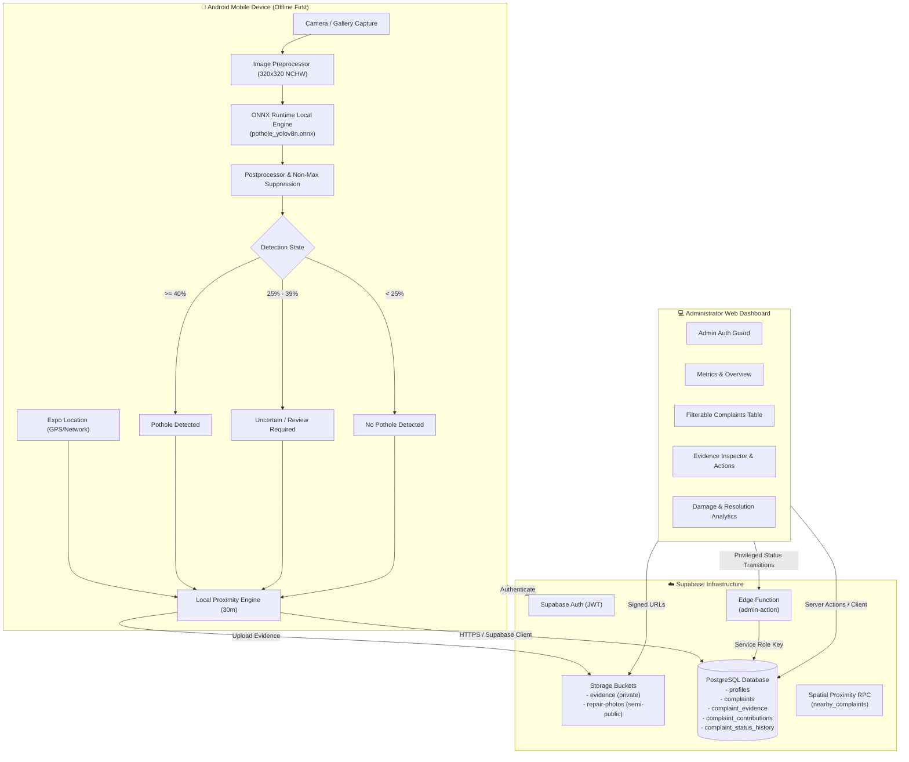

# System Architecture

## Overview

RoadGuard is structured as a monorepo containing three core tiers:
1. **Mobile Application (`apps/mobile`)**: Expo React Native Android application with on-device YOLO ONNX Runtime inference, GPS coordinates capture, duplicate detection, and offline capability.
2. **Administrator Web Application (`apps/admin`)**: Next.js 16 App Router application for municipal road authority staff to review, verify, assign work crews, and resolve reports.
3. **Backend & Machine Learning (`supabase/`, `ml/`)**: Supabase PostgreSQL database with Row Level Security, Storage buckets, Edge Functions, and Ultralytics YOLOv8 ONNX model training/export pipelines.

---

## Architecture Diagram

---

## Offline-First Design

1. **Local Model Execution**:
   - The YOLOv8n ONNX model (`pothole_yolov8n.onnx`) is physically bundled within the mobile app binary (`apps/mobile/assets/models/`).
   - Inference does **not** rely on external APIs or network connectivity. Image inference operates seamlessly even when the device is in Airplane Mode.

2. **Honest Uncertainty Representation**:
   - Detections with confidence scores below the high-confidence threshold (40%) but above the uncertainty noise floor (25%) are labeled as `uncertain_low_confidence`.
   - The user interface clearly communicates uncertainty to the citizen, avoiding false positives.
   - Uncertain reports are submitted with `pending_verification` status, requiring administrator review.

3. **Geospatial Duplicate Checking**:
   - Upon capturing GPS coordinates (latitude, longitude, accuracy), the app queries existing active reports within a 30-meter radius using the PostgreSQL `nearby_complaints()` RPC function.
   - Citizens can choose to add corroborating evidence or confirmations to existing complaints instead of duplicating tickets.

4. **Privileged Operations via Edge Functions**:
   - Status updates (e.g., `verified`, `assigned`, `in_progress`, `resolved`, `rejected`) require administrative authority.
   - The `admin-action` Supabase Edge Function validates the caller's JWT, verifies their role (`admin` or `moderator`) in `profiles`, applies status transitions, logs an entry in `complaint_status_history`, and records who modified the ticket.
