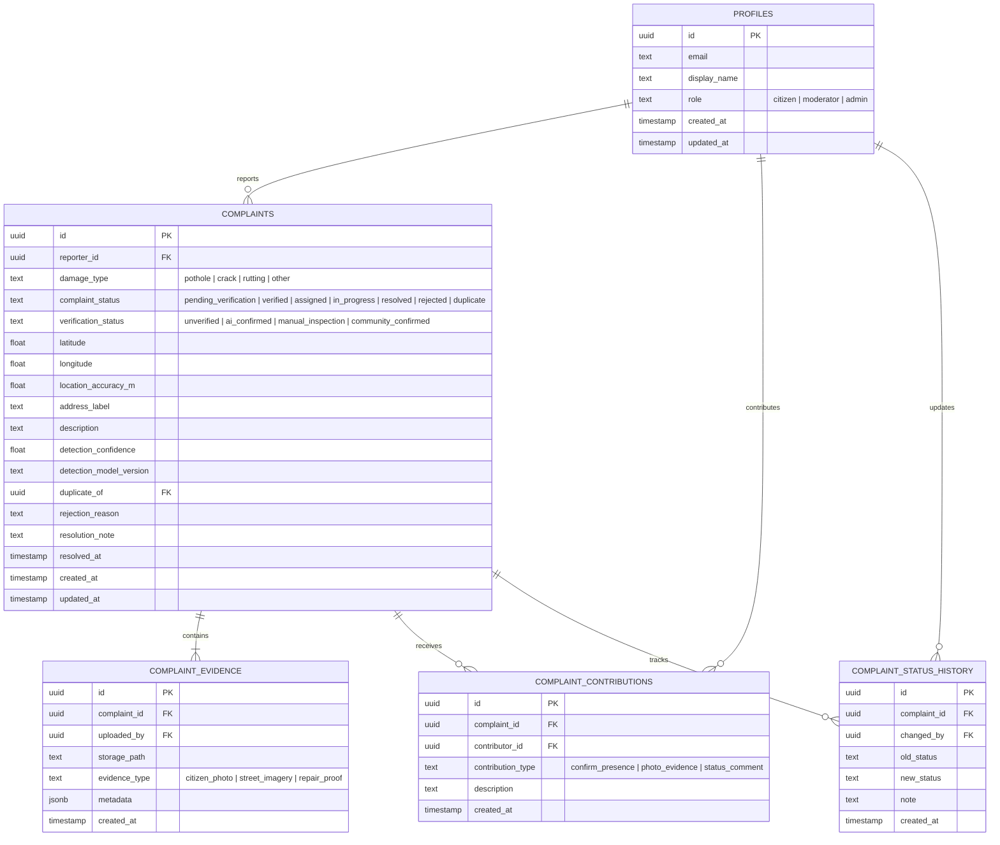

# Database Schema & Security Specification

## Overview

The RoadGuard backend utilizes Supabase PostgreSQL with extensions (`cube`, `earthdistance`, `uuid-ossp`) and Row Level Security (RLS) enabled on all tables.

---

## Entity Relationship Diagram



---

## Spatial Indexing & Proximity Function

Instead of a heavy PostGIS extension installation, RoadGuard implements PostgreSQL's native `cube` and `earthdistance` extensions, enabling indexable, highly efficient spherical distance queries:

```sql
CREATE OR REPLACE FUNCTION nearby_complaints(
    lat double precision,
    lon double precision,
    radius_meters double precision DEFAULT 30.0
)
RETURNS TABLE (
    id uuid,
    damage_type text,
    complaint_status text,
    verification_status text,
    latitude double precision,
    longitude double precision,
    address_label text,
    distance_meters double precision,
    created_at timestamptz
)
LANGUAGE plpgsql
SECURITY DEFINER
AS $$
BEGIN
    RETURN QUERY
    SELECT
        c.id,
        c.damage_type,
        c.complaint_status,
        c.verification_status,
        c.latitude,
        c.longitude,
        c.address_label,
        earth_distance(
            ll_to_earth(lat, lon),
            ll_to_earth(c.latitude, c.longitude)
        ) AS distance_meters,
        c.created_at
    FROM complaints c
    WHERE
        c.complaint_status NOT IN ('resolved', 'rejected', 'duplicate')
        AND earth_box(ll_to_earth(lat, lon), radius_meters) @> ll_to_earth(c.latitude, c.longitude)
        AND earth_distance(ll_to_earth(lat, lon), ll_to_earth(c.latitude, c.longitude)) <= radius_meters
    ORDER BY distance_meters ASC;
END;
$$;
```

---

## Row Level Security (RLS) Policies

1. **`profiles`**:
   - `SELECT`: Public can read citizen display names and roles.
   - `INSERT / UPDATE`: Users can only edit their own profile (`auth.uid() = id`).
2. **`complaints`**:
   - `SELECT`: Citizens can view active complaints.
   - `INSERT`: Authenticated users can insert complaints where `reporter_id = auth.uid()`.
   - `UPDATE`: Citizens cannot mutate status directly; only administrators via Edge Function or direct service role.
3. **`complaint_evidence`**:
   - `SELECT`: Viewable by authenticated users.
   - `INSERT`: User can attach evidence to complaints.
4. **`complaint_contributions`**:
   - `SELECT`: Publicly viewable for community transparency.
   - `INSERT`: Authenticated users can contribute notes or confirmations.
5. **`complaint_status_history`**:
   - `SELECT`: Openly viewable for auditability and transparency.
   - `INSERT`: Restricted to system functions and authorized administrators.
